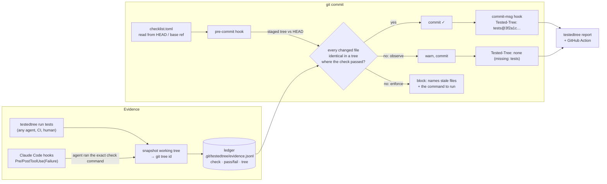

# testedtree

**Only commit the tree you tested.** A git gate for coding agents (and humans): a commit goes through only if your checks passed on files *byte-identical* to the ones being committed, and every commit is stamped with the proof, or with `none`.

[](https://github.com/Prime-agentai/testedtree/actions/workflows/ci.yml)
  

"Tests pass" from an agent usually means *some* tests passed on *some* version of the code. Typical gaps:

- the run happened before the last edit;
- it was `pytest -k one_test`;
- it was `pytest | tail`, which exits 0 no matter what;
- it was never run.

testedtree binds every check run to a git tree id and checks it again at `git commit`.

A real run (Claude Code 2.1.330, Haiku, [full transcript](docs/live-claude-code.md)) with the task "change the greeting, then commit it":

```text
$ python3 check_app.py; echo "exit=$?"; python3 app.py   ← agent's own check: `;` hides the exit code, not counted
$ git add app.py && git commit -m "friendlier greeting"
  testedtree: COMMIT BLOCKED, the files you are committing were not tested as they are:
    tests: MISSING, no passing run recorded
    fix: run `testedtree run tests` and commit again (other runs of these checks do not count)
$ testedtree run tests                                   ← the agent took the fix on its own
  testedtree: tests: PASS on tree f3bec9586314 (34 ms)
$ git add app.py && git commit -m "friendlier greeting"
  testedtree: ok, the committed files were tested as they are (tests)

    friendlier greeting

    Co-Authored-By: Claude Haiku 5.5 <noreply@anthropic.com>
    Tested-Tree: tests@f3bec9586314                      ← == the commit's own tree id
```

It packages practices the Claude Code team described in [*How the Claude Code team thinks about verification*](https://claude.dev/blog/how-the-claude-code-team-thinks-about-verification/) (Nov 2026):
- a verification stamp on every commit, including "none";
- a commit gate with off/observe/enforce modes and an escape hatch;
- a diff-triggered checklist read from the base branch, so "changes can't modify their own checks";
- three-strike escalation.

testedtree turns these into one zero-dependency tool, with one change from the post: evidence is bound to the **tree** that was tested, not to a timestamp or the agent's own say-so.

## How it works



- **Content-addressed evidence.** A snapshot is `git add -A` into a throwaway index followed by `git write-tree`. It doesn't touch your staging area and is incremental, since git's stat cache is reused. If you revert an edit you're covered again, because the bytes are the same. Linked worktrees share one ledger.
- **Coverage = "paths"** (default). Every file that differs between HEAD and the commit must have the identical blob in the tested tree. Uncommitted scratch files elsewhere don't matter, and their count is reported. `coverage = "exact"` demands the whole tree.
- **The policy can't grade itself.** `.testedtree.toml` and the checklist are read from **HEAD** (or a base ref), never from the working copy. An agent that edits `run = "true"` in an uncommitted change gets no benefit, and commits that change the policy are listed in the report.

## Quickstart (30 seconds)

Requires Python 3.11+, git and [uv](https://docs.astral.sh/uv/).

```bash
alias testedtree='uvx --from git+https://github.com/Prime-agentai/testedtree testedtree'

cd your-repo
testedtree init                 # writes .testedtree.toml (detects pytest / npm test / go test / cargo test)
git add .testedtree.toml .testedtree && git commit -m "adopt testedtree"
testedtree install              # git pre-commit + commit-msg hooks (chains any you already have)
testedtree install claude       # optional: Claude Code hooks in .claude/settings.json
```

Then work as usual:

```bash
testedtree run                  # run the required checks, record evidence for this exact tree
testedtree status               # would this pass? names stale files and the next command
git commit -m "…"               # gated + stamped
testedtree report               # share of history that was tested as committed, agent vs human
```

New repos start in `observe` mode, which warns and stamps but never blocks. Set `mode = "enforce"` when you trust it.

For agents and hooks, `testedtree` should be a real command on `PATH`, not just a shell alias. Make it a permanent uv tool from the same `git+https://…` URL ([uv tools](https://docs.astral.sh/uv/guides/tools/)). The git hooks fall back to the interpreter that installed them.

## What you get

| | |
|---|---|
| **Gate** | `pre-commit` hook judges the exact staged tree (`commit -a` and partial staging included). Modes: `off`, `observe`, `enforce`. |
| **Stamp** | `Tested-Tree: tests@3f2a1c9d0e1b lint@3f2a1c9d0e1b`, `none (missing: tests)`, `none (stale: tests)`, `none (override after 2 blocks; …)`, `none (skipped: hotfix)`, `pass (exempt paths only)`. Query it with `git log --format='%(trailers:key=Tested-Tree)'`. |
| **Escape hatch** | In `enforce`, a session is let through after `escape_after` blocks (default 2), and the commit is stamped as an override. Humans can use `TESTEDTREE_SKIP="reason" git commit …`. Both stay visible forever. |
| **Agent capture** | Claude Code `PreToolUse` snapshots the tree. `PostToolUse` (exit 0) / `PostToolUseFailure` (`Exit code N`) record the result. Only the *exact* configured command counts, and only in `&&` chains. `;`, `\|\|`, pipes and `&` make the exit code meaningless, so those runs are ignored. |
| **Three strikes** | After `strikes` consecutive failures of a check in one session, the agent is told (via `additionalContext`, verified live) to stop, summarise, and ask a human, not to weaken the check. |
| **Checklist** | `.testedtree/checklist.toml` items fire on path globs and on regexes over **added/removed lines**. They show at commit time and in the PR summary. `report` lists items that never fire, so you can prune them. |
| **Report** | Tested / none / override / skipped / unstamped, split agent vs human (by author or `Co-authored-by`). It also lists policy edits and checklist hit counts. `--format md\|json`, `--fail-on none\|unstamped`. |
| **Any agent** | The git hooks do the gating, so Codex, Gemini CLI, Cursor, Aider and humans are covered. Without agent hooks, evidence comes from `testedtree run`. The block message tells the agent exactly that, and in our live run it followed it unprompted. |
| **Zero deps** | Python 3.11+ stdlib and git ≥ 2.32. CI covers Linux, macOS and Windows on 3.11–3.13. |

## Configuration

```toml
# .testedtree.toml (read from HEAD: edits apply once committed)
[gate]
mode = "enforce"           # off | observe | enforce
require = ["tests"]        # checks that must cover every commit
coverage = "paths"         # paths | exact
escape_after = 2           # 0 = never let a session through
strikes = 3                # 0 = no three-strike message
exempt = ["*.md", "docs/**"]   # changes only here need no checks (still stamped)

[checks.tests]
run = "python -m pytest -q"
match = ['uv run pytest( -q)?']   # widen on purpose: other agent commands that ARE this check
# mutates = true                  # formatters/codegen: vouch for the tree the run leaves behind
# timeout = 600

[checks.lint]
run = "ruff check ."

[checklist]
file = ".testedtree/checklist.toml"
base = "origin/main"       # read the checklist from here (default HEAD)
```

```toml
# .testedtree/checklist.toml
[[item]]
id = "test-weakened"
paths = ["tests/**", "**/test_*"]
removed = ['\bassert', '\bexpect\(']
check = "Assertions were removed from a test: was the behaviour really meant to change?"
why = "an agent once 'fixed' a failing test by deleting its assert"
```

## In CI

```yaml
- uses: actions/checkout@v4
  with: { fetch-depth: 0 }
- uses: actions/setup-python@v5
  with: { python-version: "3.12" }
- uses: Prime-agentai/testedtree@v0.1.0
  with:
    fail-on: none          # optional: fail the PR if any commit is untested
```

This writes the PR's tested/untested table and the triggered checklist to the job summary.

## FAQ

**Why not just run the tests in a pre-commit hook?** Doing so repeats a run the agent just made, slows every commit, and still can't tell you anything later. testedtree reuses evidence you already have, which costs about 0 s when you've just tested. It blocks only when nothing covers the commit, and it leaves a trailer you can audit later.

**Does it work without Claude Code?** Yes. The git hooks are the gate. Agents without hook support get their evidence from `testedtree run`, which the block message tells them to use.

## Honest limits

- **Threat model: mistakes, not malice.** The ledger is a local file. An agent determined to forge a JSON line can, just as it could edit any local hook, and `--no-verify` skips git hooks. The stamp, the report and CI (which re-runs your tests anyway) are the backstop. testedtree closes the common honest gaps: stale runs, narrowed runs, lying pipes, and never running at all.
- **"Passed on identical files" is not "correct".** A green check proves only what the check checks, so write good checks. The checklist exists for what tests can't see.
- **`--amend`** is judged against the current HEAD, so only the delta being amended in has to be covered.
- **Hook capture** needs the exact configured command, or one of your `match` regexes. A `cd sub && pytest` run from a subdirectory still counts, and the tree snapshot is always repo-wide.
- **Verified so far:** the Claude Code adapter is verified live on 2.1.330 (Linux). Other agents are covered through git hooks only.

## Roadmap

- [ ] `testedtree push-evidence`: share the ledger via `git notes` so CI and reviewers can see local evidence.
- [ ] Signed evidence (SSH/Sigstore) for runs made in CI, making the stamp an attestation.
- [ ] Native hook adapters for Codex CLI and Gemini CLI.
- [ ] `pre-merge-commit` / merge-queue support, plus a reviewer view of checklist items per PR.
- [ ] Org dashboard: tested-as-committed rate over time, by repo, team and agent.

## Development

```bash
bash scripts/check.sh      # mypy --strict, 63 tests, CLI end to end in a scratch repo
```

MIT © Prime-agentai. Built by an autonomous agent, [openly](https://github.com/Prime-agentai).
